# CityBus Ridership and Weather Analysis

Purdue University · January–April 2025. Faculty mentor: Xing Wang. Industry partner: CityBus of Greater Lafayette. Team: Kelly Igo, Anushka Sharma, Lejia Zhou and Chau Nguyen.

## Research question
How do weather and academic timing relate to daily ridership, and how do model performance and demand patterns differ across routes and periods? The team studied 19 routes. Chau's contribution focused on off-campus routes 1A, 2B, 6A and 6B and the report conclusion.

## Dataset
`data/off_campus_routes.csv` contains the supplied daily analysis table: 327 observations, four route ridership measures, 24 weather variables and WorkDate. Values, row order and missing values match sheet 2 of the project workbook. It contains aggregate route observations rather than individual passenger records.

## Methods
- Explore route-level monthly/weekday patterns and weather associations.
- Investigate regression with variable selection, interactions and transformations.
- Compare linear regression, decision trees and Random Forest; extended experiments also examine k-nearest neighbors and XGBoost.
- Study both transfer between selected periods and chronological 80/20 evaluation within a selected period.
- Report R² as 1−SSE/SST, RMSE and MAE. Squared correlation is a separate statistic.

The main runner evaluates two specified samples: `source_rows` selects 119 observations; `report_months` selects July, August and November. Missing route outcomes are excluded from fitting and scoring. The Route 1A source_rows split has 95 training and 24 test observations. Its test Random Forest R² is 0.105483 and RMSE is 140.2316. All route/model results are in `results/recomputed-metrics.csv`. The separate 29-observation exploratory regression has in-sample R² 0.772986.




## Run
```sh
Rscript setup.R
Rscript run_all.R
```
An explicit workbook/CSV and output path may be supplied: `Rscript run_all.R data/off_campus_routes.csv outputs`. The workflow runs input checks, EDA, exploratory regression, model comparisons, plots and prediction-derived metric checks. See DATA_SETUP.md for schema and outputs. Optional campus raw aggregation accepts separate source workbooks.

`src/segment_comparison.R` evaluates the separate-period Random Forest experiment; `src/model_experiments.R` contains additional model comparisons. `src/exploratory_weather_regression.R` explores screening, interactions and transformations.

The analysis supports route-specific planning discussions. Associations are observational; the project does not estimate a causal weather effect or measured scheduling improvement. Team and CityBus attribution should accompany reuse.

[Portfolio case study](https://chau-nguyen-research.gabledmango1.chatgpt.site/citybus.html)
