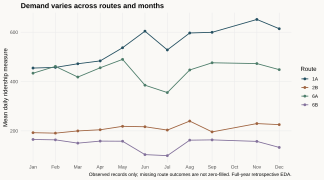
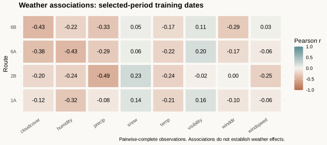
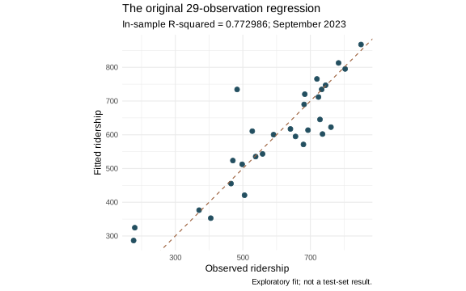

# CityBus Ridership Prediction with External Weather Data

Purdue University · January–April 2025 · Faculty mentor: Prof. Xing Wang
Industry partner: CityBus of Greater Lafayette

Team: Kelly Igo, Anushka Sharma, Lejia Zhou and Chau Nguyen (Cyrus Nguyen in the original materials).

## Project

Our team studied daily weather and ridership across 19 bus routes to inform service-planning discussions. My documented contribution was the off-campus analysis of routes 1A, 2B, 6A and 6B, and the report conclusion. The analysis connects weather preparation, route-level exploration, regression, tree models, evaluation and communication of findings.

## Run

Validated locally with R 4.4.3; use R 4.4 or later and an authorized copy of **Off Campus routes.xlsx**, sheet 2.

```sh
Rscript setup.R
Rscript run_all.R '/path/to/Off Campus routes.xlsx' outputs
```

This command runs the checks, data audit, EDA, early regression, final model comparisons, plots and result verification. An optional third argument supplies the campus raw-data folder. See [data setup](DATA_SETUP.md) for the exact schema and [workflow map](docs/WORKFLOW.md) for the analysis stages.

## Methods

1. Validate dates, route outcomes and weather measurements; examine missingness and descriptive patterns.
2. Explore route-specific monthly and weekday demand and weather correlations.
3. Study regression models through variable selection, interactions and transformations in the professionally named historical sources.
4. Reproduce the selected 29-observation Route 1A regression as an exploratory, in-sample fit.
5. Compare multiple linear regression, an ANOVA regression tree and Random Forest on fixed, chronological 80/20 partitions; include a training-mean reference.
6. Compute R², RMSE and MAE from the same observed outcomes, inspect errors and feature importance, and communicate route-specific planning implications.

The default single-run comparison preserves the original 119-row selection (`source_rows`). The full runner also evaluates July, August and November as the separate `report_months` sensitivity analysis. Each has disjoint training and test dates. Missing route outcomes are not synthesized. R² is `1 − SSE/SST`; squared correlation has its own output field. Forest importance uses regression node impurity.

## Results and visual evidence

The selected early regression reproduces **R² = 0.772986**, or **0.773**, on its **29-observation in-sample fit**. The final presentation reports Random Forest test R² 0.7546, but the associated source test indices overlap 71 training observations. It is a historical reported score, not verified held-out performance. The corrected source-selection Route 1A test R² is 0.105483. This discrepancy remains material to the SOP claim. Each reported or computed table has an explicit experiment and source in [result documentation](RESULTS_PROVENANCE.md).







## Repository guide

| Files | Purpose |
| --- | --- |
| `prepare.R`, `raw_aggregation.R` | Workbook validation and optional campus event aggregation |
| `eda.R`, `regression_exploration.R` | Descriptive analysis and early regression |
| `functions.R`, `run.R` | Period definitions, chronological splitting and final models |
| `diagnostics.R`, `plot.R` | Figures generated from computed predictions and metrics |
| `audit_source.R`, `verify_results.R` | Date separation, metric definitions and reproducibility checks |
| `reported_results.R` | Explicit transcription of the final presentation's table |
| `results/`, `figures/` | Aggregate evidence and regenerated visualizations |

Original scripts are preserved in a private backup. Professional source files retain team attribution. Runnable files use explicit inputs and relative paths. Data, fitted models and individual prediction records are kept outside version control.

## Implications

The project recommends considering route-specific demand, weather and academic timing when planning service. These are qualitative recommendations; the study does not measure a deployed scheduling improvement or identify a causal weather effect.

## Supporting materials

- [Executed validation](docs/VALIDATION.md)
- [Portfolio case study](https://chau-nguyen-research.gabledmango1.chatgpt.site/citybus.html)

Retain team credit when sharing. This repository does not grant redistribution rights over source data or assert an open-source license.

## Explicit corrections
The diagnostic workflow fixes `ncol` to a disjoint row/date partition, excludes missing route outcomes instead of globally imputing them, and resets seed before each model to make independent reruns stable. These are documented corrections; they do not reproduce the historical evaluation. Date selections and models were not tuned to obtain 0.7546. Frozen numerical references are compared with current results; version differences are recorded, while split and metric identities must pass. SVG export uses svglite.

## Historical experiments
`src/historical_model_experiments.R` preserves the final source’s regression selection, random/chronological experiments, k-NN, XGBoost, decision tree and Random Forest variants, with professional comments and an explicit workbook input. XGBoost and k-NN were already in the source; they were not introduced during restoration. The known overlapping split remains annotated for traceability. Do not treat its output as valid held-out evaluation. Extra packages for this historical path are leaps, xgboost and rpart.plot.

The historical full experiment path was rerun in R 4.4.3. Its final forest gives R² approximately 0.758 on the overlapping indices, close to the reported 0.7546 but still not valid unseen-data evidence. A plotting-only repair extracts importance from `model7$finalModel`; training and predictions remain unchanged. `src/exploratory_weather_regression.R` also retains the earlier screening, transformations and interaction exploration.
